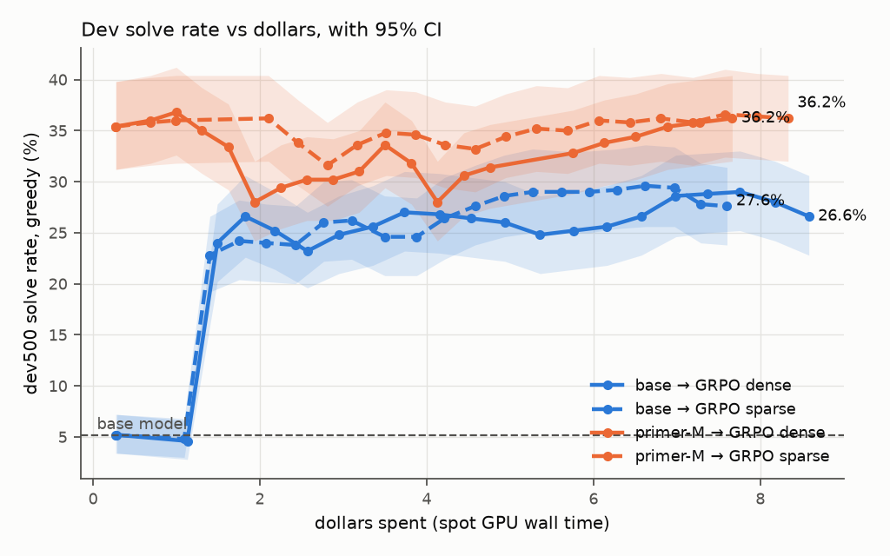
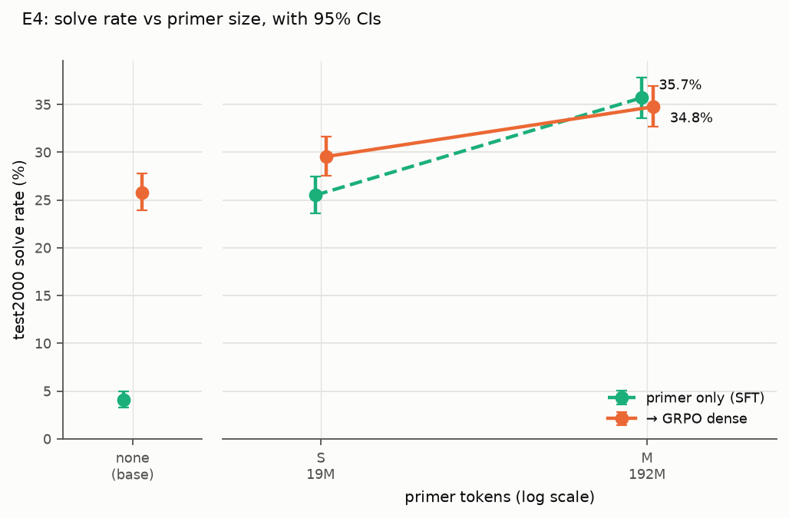

# Knight School

Teaching a 2B open LLM chess tactics with supervised fine-tuning and reinforcement learning, on a
fixed cloud budget, with every prediction written down before the run and every dollar logged.

> **A teacher-free chess primer took Qwen3.5-2B from 4.1% to 35.7% on 2,000 held-out Lichess
> puzzles. GRPO from the base model plateaued at 26–28%, as Chess-R1 found. GRPO on top of the
> primer added nothing.** The whole project cost **$197.74** of $600 in cloud credits.

[**Puzzle browser**](https://nikext.github.io/knight-school/): every puzzle, every model's answer ·
[Results with predictions](docs/RESULTS.md) · [Decisions (ADRs)](docs/DECISIONS.md) ·
[Blog draft](docs/BLOG.md) · Models and data on Hugging Face (links below)

## The question

[Chess-R1](https://arxiv.org/abs/2507.00726) (KAIST & KRAFTON, 2025) trained 3–8B LLMs with GRPO on
Lichess puzzles. Every model plateaued at roughly 25–30% puzzle accuracy, and with a sparse "right
move or not" reward the 3B model did not learn at all. The authors' diagnosis: the base models lack
chess knowledge, and RL cannot add knowledge that isn't there.

Knight School tests the follow-up on an off-the-shelf small model:

> **Does a cheap, teacher-free "chess primer" (SFT on board reading, rules and Stockfish-annotated
> positions, built entirely from CC0 Lichess data) raise the RL ceiling? How does it scale with
> primer size, and is it the rules or the Stockfish moves that matter?**

No LLM-written text is used anywhere. Every training signal comes from python-chess (rules) or
Stockfish 19 (move quality).

## Results

test2000: 2,000 held-out Lichess puzzles, split from training by game, stratified over 12 rating
bins (400–2799). Qwen3.5-2B, greedy, the legal moves listed in the prompt; a puzzle is solved when
every solver move is right. 95% bootstrap CIs; Δ is a paired bootstrap on the same puzzles.

| Model | test2000 solve | Δ vs GRPO from base (same reward) |
|---|---|---|
| random legal move | 0.8% [0.4, 1.2] | |
| Qwen3.5-2B, zero-shot | 4.1% [3.2, 5.0] | |
| base → GRPO, dense Stockfish reward (E2) | 25.8% [23.9, 27.8] | reference |
| base → GRPO, sparse reward (E2) | 28.0% [26.1, 30.0] | reference |
| **primer-M (SFT only)** | **35.7% [33.6, 37.9]** | +9.9 [+8.2, +11.8] vs dense |
| primer-M → GRPO, sparse (E3) | 35.4% [33.4, 37.6] | **+7.4 [+5.8, +9.2]** |
| primer-M → GRPO, dense (E3) | 32.6% [30.5, 34.7] | **+6.8 [+5.2, +8.4]** |
| primer-M → GRPO, dense, entropy target 0.14 | 34.8% [32.6, 36.9] | +8.9 [+7.3, +10.5] |
| rules-only primer → GRPO, dense (E5a) | 26.2% [24.3, 28.1] | +0.4 [−1.0, +1.8] |
| Stockfish 19, 1 node (reference) | 68.6% [66.6, 70.6] | |



*dev500 during GRPO, by dollars spent. Blue: GRPO from the base model jumps to ~25% within $2 and
stays there. Orange: GRPO from the primer starts at the primer's 35% and ends there. The primer
SFT itself cost $22 and is not on the x-axis.*



*E4: primer size. More primer, higher post-RL score (none 25.8% < S 29.5% < M 34.8%, each step a
paired Δ whose CI excludes 0). RL added +4.0 points to the small primer and nothing to the large one.*

| Hypothesis | Verdict |
|---|---|
| H1: primer → RL beats RL from the base | **holds**, +6.8 to +7.4 points |
| H2: sparse reward on the primer stays flat | falsified as stated: sparse RL works from the base (4.1% → 28.0%) and left the primer where it was |
| H3: post-RL score rises with primer size | **holds**, monotone over three sizes (L was dropped) |
| H4: rules alone give half the gain | **fails**: +0.4 points |
| H5: RL adds to the primer | fails for primer-M (−3.1 to −0.2), holds for primer-S (+4.0) |

## What I learned

- **The gain came from the SFT, not the RL.** Primer-M alone beat every RL run. GRPO on top of it
  kept the score at best (sparse −0.2) and cut pass@8 from 51% to 43–47%: it sharpened the
  distribution without finding new solves.
- **Rules knowledge didn't transfer to tactics.** A rules-only primer taught board reading (94–99% on the
  probe's square and FEN-after-a-move tasks) and puzzle solving not at all (+0.4 after RL). What mattered was the move-choice
  data: Stockfish's best move and the puzzle solutions.
- **The skill is narrower than the number.** Remove the legal-move list from the prompt and the best
  model drops from 35% to 1.9%. It learned to pick the tactic from a list, not to generate moves.
- **The failures were in the RL plumbing.** Entropy collapse (74% of groups gave no gradient by step
  50), then text rambling on after `</answer>` and filling the 1,024-token cap, which froze sparse
  v2's answers. Then an entropy target tuned on the base model that pushed the primer model off its
  answers. Each fix got its own config version and ADR (021, 022, 025, 027).
- **Write the prediction first.** Several of mine were badly wrong: 1-node Stockfish at 30–45%
  (68.6%), GRPO-from-base at ~10% (24%), the no-list primer at ~29% (1.7%). Each miss is on record in
  RESULTS.md, next to the prediction.

## Cost

| | Spent | Notes |
|---|---|---|
| GPU (spot A100 80GB, 61 h) | $190.68 | 14 finished training runs (3 SFT, 11 GRPO), 4 stopped, plus evals; 23 spot preemptions, mostly absorbed by resuming from checkpoints |
| Other compute (L4, H100 throughput test, smoke VMs) | $3.58 | |
| Storage, registry, egress | $3.47 | GCS checkpoints to the Nov 10 teardown, registry, model download |
| Gemini baselines | $0 | pending: they wait for the second credit (2026-11-13) |
| **Total** | **$197.74 of $600** | ceilings $360 compute + $180 Vertex; nothing on real money |

Spot GPUs only, one at a time (quota 1). Every job goes through a gate that refuses it if its worst
case could break a ceiling or outlive the credit, and it lands in an append-only
[ledger](costs/ledger.jsonl). Budgets and a kill switch that detaches billing are the backstop. The
rules are in [docs/BUDGET.md](docs/BUDGET.md).

## Release

- Models (Apache-2.0, merged weights): primer-M, primer-M → GRPO sparse, primer-M → GRPO dense, on
  Hugging Face (links added on release).
- Dataset (CC0): test2000, dev500, probe500, the 66k RL positions with Stockfish scores for every
  legal move, and a primer sample. The full primer is regenerated with `make data`.
- [Puzzle browser](https://nikext.github.io/knight-school/) (`site/`): all 2,000 test puzzles with
  each model's answer, filters by rating, theme and outcome, and a solve-it-yourself mode.

## Reproduce

```bash
make setup          # uv sync, pre-commit
make data           # Lichess puzzles -> splits -> positions -> Stockfish reward tables -> primer (laptop)
uv run ks launch configs/runs/<run>.yaml            # shows the gate; --confirm launches on a spot GPU
make eval MODEL=qwen3.5-2b SET=test2000 CKPT=gs://… # the eval harness
uv run ks browser-data && (cd site && npm ci && npm run dev)   # the puzzle browser
```

This repo was built milestone by milestone with Claude Code, one session per milestone, from the
task files in [docs/tasks/](docs/tasks/) and the working agreement in [CLAUDE.md](CLAUDE.md).

## Docs

| File | What's in it |
|---|---|
| [docs/RESULTS.md](docs/RESULTS.md) | Predictions and measured results, all experiments |
| [docs/DECISIONS.md](docs/DECISIONS.md) | ADRs |
| [docs/RESEARCH.md](docs/RESEARCH.md) | Question, prior work, hypotheses, experiment design |
| [docs/DATA.md](docs/DATA.md) | Lichess data, splits, Stockfish rewards, primer tasks |
| [docs/TRAINING.md](docs/TRAINING.md) | Models, SFT and GRPO setup, checkpoints |
| [docs/EVALS.md](docs/EVALS.md) | Eval sets, metrics, harness, baselines |
| [docs/BUDGET.md](docs/BUDGET.md) | Money rules, allocations, guardrails, ledger |
| [docs/GCP.md](docs/GCP.md) | Project, quotas, launch backends, kill switch, teardown |
| [docs/PLAN.md](docs/PLAN.md) | Milestones and status |
| [docs/BLOG.md](docs/BLOG.md) | Write-up draft |

## License

Code: Apache-2.0. Lichess puzzle and evaluation databases: CC0. Stockfish is GPL-3.0; it is used as
a tool and not redistributed. Released models inherit Qwen3.5-2B's Apache-2.0.
